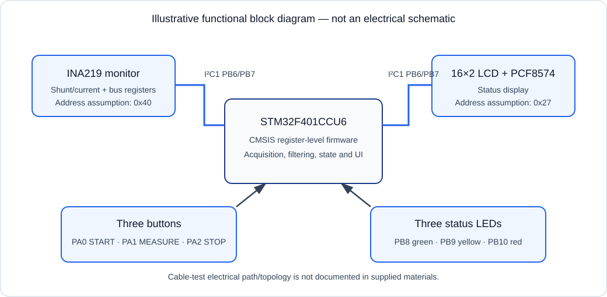
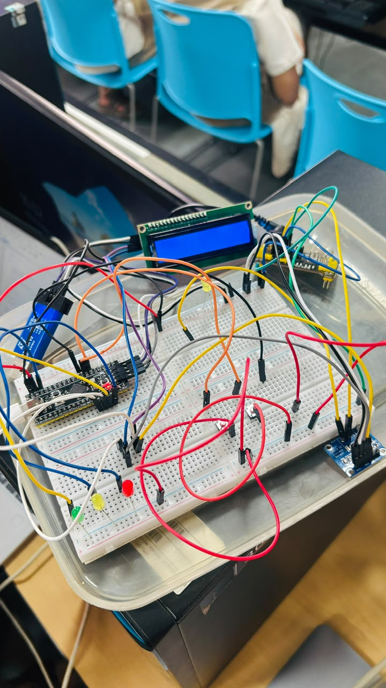

# Portable Cable Fault Localization and Distance Estimation Instrument

A low-voltage cable-test prototype built around an STM32F401CCU6 Black Pill,
an INA219 monitor, a 16×2 I²C LCD, three push buttons, and three status LEDs.
The supplied firmware reads INA219 shunt/current and bus-voltage registers,
shows status on the LCD, and indicates a sustained low-current/no-current
condition. It does **not** locate a physical fault.

## Current status

| Capability | Status |
|---|---|
| INA219 register acquisition and LCD/LED/button interface | Implemented in source; not hardware-validated |
| Repeated-sample low-current indication | Implemented; thresholds are provisional and topology-dependent |
| INA219/I²C and invalid-bus error states | Implemented in source; not hardware-validated |
| Short-to-ground, conductor-to-conductor, resistive, or intermittent fault classification | Not implemented / not validated |
| Physical fault-distance measurement | Not implemented; display reports `DIST: NOT CAL` on low-current results |
| Experimental accuracy or supported cable range | No results supplied |

## Architecture

The diagram is a functional overview only. It is **not** an electrical
schematic, and it does not assert undocumented pin-to-pin test-path wiring.



The MCU reads the INA219 and writes LCD data through I²C1. Buttons and LEDs use
GPIO. The supplied files do not define a validated cable measurement topology.
See [hardware documentation](hardware/README.md).

## Hardware and firmware pin map

These are the pins configured in the firmware, not independently verified
connections from the photograph.

| STM32F401 pin | Firmware function | Configuration / verification |
|---|---|---|
| PB6 | I²C1 SCL | AF4, open-drain; provide suitable external pull-up(s) |
| PB7 | I²C1 SDA | AF4, open-drain; provide suitable external pull-up(s) |
| PA0 | START | Input with internal pull-up; button is active-low |
| PA1 | MEASURE | Input with internal pull-up; button is active-low |
| PA2 | STOP | Input with internal pull-up; button is active-low |
| PB8 | Green LED | Push-pull output; firmware drives high to turn on |
| PB9 | Yellow LED | Push-pull output; firmware drives high to turn on |
| PB10 | Red LED | Push-pull output; firmware drives high to turn on |

The firmware assumes a 7-bit INA219 address of `0x40` and LCD backpack address
of `0x27`. Both are configurable in
[Cable_Fault_Localizer.c](firmware/src/Cable_Fault_Localizer.c). The PCF8574
mapping is assumed to be P0=RS, P1=R/W, P2=E, P3=backlight, P4–P7=D4–D7; verify
the actual backpack before use. The photo does not establish the addresses,
pull-up values, or exact wiring.

## Firmware and build

The source is CMSIS register-level C for the STM32F401 family. It is not a HAL
project. The firmware explicitly selects HSI at 16 MHz with APB1 prescaled /1,
then derives the I²C1 timing values from that declared clock.

Prerequisites:

- Keil µVision with ARM Compiler, or a compatible `arm-none-eabi-gcc` toolchain.
- STM32 CMSIS core and STM32F4 device headers, including `stm32f4xx.h`.
- An STM32F401CCU6 target/device selection and suitable startup code.

No Keil project, startup file, linker script, or GCC build system was supplied.
Do not treat the following compile-only example as a complete firmware image;
adapt include paths to the installed CMSIS package:

```sh
arm-none-eabi-gcc -std=c99 -mcpu=cortex-m4 -mthumb -Wall -Wextra \
  -ffreestanding -I<cmsis-core-include> -I<stm32f4-device-include> \
  -c firmware/src/Cable_Fault_Localizer.c -o Cable_Fault_Localizer.o
```

For a complete build, add startup code and a linker script for STM32F401CCU6,
then link with the CMSIS/system files required by the selected toolchain.
Configure Keil for the STM32F401CCU6 / Cortex-M4 target and the same startup,
memory, and clock assumptions. Flash with the programmer/debugger configured
for the assembled board; no flash project or board validation log is included.

## Controls and indicators

- **START (PA0):** initialize/retry the INA219 and enter READY.
- **MEASURE (PA1):** acquire five samples, nominally 100 ms apart, and show
  their mean current plus the latest bus voltage.
- **STOP (PA2):** cancel an active acquisition or return to OFF; the LEDs turn
  off. A STOP press is polled during the sample sequence.
- **Green:** READY or a result with no low-current/error indication.
- **Yellow:** sampling in progress.
- **Red:** low-current/no-path indication or an error.
- **All off:** OFF/idle.

The debounce routine uses a bounded wait for button release. The LCD and I²C
error states may require a power cycle if the LCD itself stops responding.

## INA219 calibration

Verify the actual INA219 module shunt marking or measure the shunt before using
current readings. `INA219_SHUNT_UOHM`, `INA219_CURRENT_LSB_UA`, and
`INA219_CAL_VALUE` are user configuration values in the source; the supplied
values assume a **0.1 Ω shunt** and **100 µA/bit** and are not confirmed for
the pictured module.

Use the INA219 relationship:

```text
Current_LSB (A/bit) = selected current scale
CAL = trunc(0.04096 / (Current_LSB × R_SHUNT))
Current (A) = signed CURRENT_REGISTER × Current_LSB
Shunt voltage = signed SHUNT_VOLTAGE_REGISTER × 10 µV
Bus voltage = (BUS_VOLTAGE_REGISTER >> 3) × 4 mV
```

For the source's example values only:
`CAL = 0.04096 / (100 µA × 0.1 Ω) = 4096`. Recalculate `CAL` and the current
LSB together for the actual shunt and range. Compare readings against a
reference meter before using them in any experiment.

## Safety and measurement limits

**Use only de-energized, current-limited, low-voltage cable samples. Never
connect this prototype to mains, an energized cable, or an uncontrolled source.**
Use current limiting and verify the source is off before changing connections.

The low-current threshold currently set in firmware is a provisional 2 mA
entry threshold with a 3 mA recovery threshold. It is not an experimentally
validated limit. A low reading means only that the sensed current in this
particular setup is low; it does not uniquely prove an open cable. A missing
source, disconnected load, sensor/wiring issue, or unsuitable test topology can
produce the same observation.

The INA219 current register alone cannot determine cable resistance or fault
distance. A defensible distance estimate requires a defined path, voltage and
current measured across that same cable section, a cable-specific resistance
per length calibration, and compensation for shunt, lead, and contact
resistance. No such complete measurement topology or calibration is supplied.
Distance calculation is therefore not implemented; do not enable or infer one.

## Calibration and experiments

Follow [the calibration procedure](docs/calibration_procedure.md) before
collecting data. Record real measurements only in
[the validation log](docs/validation_log_template.csv); its rows are
intentionally blank. Keep the sample de-energized, use a current-limited
low-voltage source, record cable and temperature details, and use a reference
meter. Do not report unmeasured accuracy, range, or fault coverage.

## Hardware photo gallery

The only supplied photo is shown below. It documents the prototype appearance;
it is not clear enough to validate pin-to-pin connections.



Photo caption: supplied breadboard prototype image; component identity and
electrical connections are not verified from this view.

Future gallery slots (no substitute images have been created):

- [Top-view photo slot](hardware/photos/top_view.jpg) — not supplied.
- [Wiring detail photo slot](hardware/photos/wiring_detail.jpg) — not supplied.

## Documentation

- [Project report](docs/Project_Report.md) — current scope and methodology; no
  fabricated experimental results.
- [Project presentation](docs/Project_Presentation.pptx) — supplied slide deck.
- [Calibration procedure](docs/calibration_procedure.md).
- [Validation log template](docs/validation_log_template.csv).
- [Hardware notes](hardware/README.md).
- [Firmware notes](firmware/README.md).

## Team

- C Vasista Surya — CB.SC.U4CSE24212
- Abhigna — CB.SC.U4CSE24227
- Sannithi Lalitesh — CB.SC.U4CSE24250
- M K Bhargav — CB.SC.U4CSE24268

## Contributing, issues, and validation

Please open a bug report for source or documentation problems and use the
hardware-validation template for board observations. Before submitting
measurements, include the circuit/topology, exact parts and shunt, source
current limit, cable details, calibration, reference meter, temperature, and
uncertainty. Leave unknown fields blank. Do not label a result hardware-tested
without a dated log or photo that demonstrates the test.

Contributions should preserve the stated limits: do not infer distance from
current alone, add unverified wiring, or claim unsupported fault classes.
The project owner's GitHub profile is
[Vasista-surya](https://github.com/Vasista-surya); no repository URL was
provided for direct issue or pull-request links.

## License

No project license was supplied or selected. See [LICENSE](LICENSE); reuse
permissions are not granted by this placeholder.
